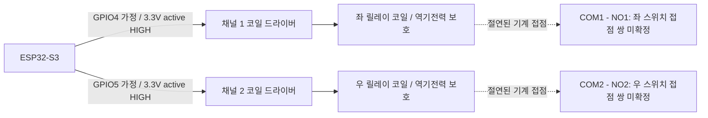

# c3-pht-porter Carrot-B1: 접점 방식 검토본

상태: 로컬 빌드·소프트웨어 검증용. 실제 보드/릴레이/차량 단자 미확인.
차량 송신, 콤마/보드 설치, 재부팅, 원격 저장소 푸시는 수행하지 않았다.

## 범위와 산출물

- 기준 저장소: parkhantae/openpilot, c3-pht-porter,
  commit 1002d4571caee836d4a44b2e64198fea593d5978.
- 사용자 첨부 CarrotB1-source-20261114-082342.zip의 BLE 인증/NVS/OTA 방식을
  기준으로 `CarrotB1Relay/` 접점 전용 스케치를 추가했다.
- 기존 CAN 스케치와 CarrotB1.bin은 다른 CAN 보드에 자동 배포되는 일을
  피하기 위해 그대로 보존한다. 포터 접점 변형은 별도 스케치로 빌드한다.
- 접점 스케치에는 TWAI 초기화, CAN 수신/송신, CAN 메시지 인코더가 없다.
- 설치 여부와 무관하게 이 변경의 적용 대상으로 지정한 브랜치는 c3-pht-porter다.

## 출력 정책

| 조건 | 처리 |
|---|---|
| 전원 투입/재부팅 | 소프트웨어 초기화의 첫 동작은 두 출력 LOW. 리셋 중에는 외부 풀다운으로 OFF 유지 |
| 인증된 Left / Right | 해당 채널만 ON, ACK는 명령 수락/출력 요청 의미 |
| 단발 | 250ms 후 OFF. 유효기간이 먼저 끝나면 더 일찍 OFF |
| HoldLeft / HoldRight | 현재 ACK된 동일 방향 출력만 유지. 꺼진 출력을 시작/재시작하지 않음 |
| Lease | 단발의 고정 시간을 늘리지 않음. 유지 출력은 즉시 해제 |
| Stop | 두 출력 OFF, ACK/유지 해제. 시간제한/충돌 차단 상태도 해제 |
| 통신 지연/유효기간 만료 | 마지막 인증 명령에 기록된 보드 시각+TTL까지, 최대 350ms 후 OFF |
| BLE 단절/새 세션/종료 핸들러 | 잠금 안에서 즉시 두 출력 OFF, 이전 세션/ACK/lease 폐기 |
| 다른 방향 유지/동작 중 새 시작 명령 | 두 출력 OFF 및 차단. STOP 전까지 새 출력 거부 |
| 연속 ON 10초 | 두 출력 OFF 및 차단. 유지 명령으로 시간 제한 연장 불가 |
| 재출력 | 이전 실제 OFF부터 100ms 경과 필요. 방향 변경 전에 두 핀을 먼저 LOW |
| OTA | 출력 동작 중 시작 거부. 업데이트 중 모든 제어 명령 무시 |
| 잘못된 HMAC/세션/순번/길이/TTL | 출력 명령으로 수락하지 않음. 재전송·미래 시각·기한 만료 패킷 거부 |

250ms/10초/100ms는 하드웨어 사양이 없는 상태의 검증값이다. 차량이 요구하는
접점 유지 방식/시간과 맞는지는 미확인이다. 1ms 주기 esp_timer 작업이 메인
루프와 독립적으로 만료를 검사한다. ESP32 전체 정지, 타이머 작업 지연, 릴레이
용착까지 차단하는 하드웨어 보증은 아니다. 물리 OFF 시점은 릴레이 복귀시간도
포함한다. 절대적인 하드웨어 제한이 필요하면 별도 코일 전원 차단 타이머가 필요하다.

## 현재 장치와 점등 사고에 대한 추가 확인

사용자가 현재 보드에는 최초 첨부한 CAN 펌웨어가 그대로 실행 중이라고
확인했다. 원본은 GPIO4=TWAI TX, GPIO5=TWAI RX이며, 릴레이 IN1/IN2
출력용 펌웨어가 아니다. 따라서 현재 릴레이 연결과의 용도 불일치가 확인됐다.
이 문서의 STOP/단절 OFF/10초 제한은 별도 CarrotB1Relay 스케치의 기능이며,
현재 장치에 이미 적용된 기능으로 해석하면 안 된다.

업로드 로그 43번 13.785초 최초 좌측 램프 피드백이 차선변경 준비와 CC의
좌측 요청보다 각각 약62ms/119ms 먼저 발생했다. 사용자는 뒤의 좌/우
전환은 끄려는 수동 레버 조작이었다고 확인했다. 로그에는 최초 점등 순간의
GPIO 파형이나 릴레이 도통 기록이 없어 순간적인 물리 원인은 미확정이다.
CAN TX 레벨이 릴레이 입력으로 전달되는 구성 오류를 먼저 제거해야 한다.

## BLE / 콤마 호환성

기존 서비스/명령/등록 UUID, 20바이트 요청, 8바이트 HMAC-SHA256 태그,
NVS `carrot-b1`의 `auth`/`owner-key`, 암호화된 최초 등록을 유지한다.
기존 등록을 유지하려면 향후 실제 설치 때 NVS 전체 삭제를 하지 않아야 한다.
미등록 보드는 등록 완료 전에는 접점을 켜지 않는다.

접점 보고는 15바이트 구조를 유지하되 version=3이다. version=2는 기존 CAN
보드다. v3의 기존 lamps 위치 1바이트는 **요청한 릴레이 출력 마스크**다.
실제 램프나 접점 도통을 측정한 값이 아니다. 콤마 모니터는 이를 `outputs`로
분리하고 `lamps=None`, `relay=True`로 전달한다. 기존 v2 콤마는 v3 보고를
거부하므로, 구형 콤마가 접점 출력을 CAN/램프 검증으로 오인하지 않는다.

콤마 변경은 v2를 계속 지원하며 v3에서는 다음을 적용한다.

- 인증된 STOP의 순번 반영을 확인한 뒤에만 정책 워커 시작.
- hold 취소/방향·ID 변경/리모컨 소실/정책 입력 만료에 다음 교환에서 STOP.
- 접점 출력은 실제 차의 lamp 확인을 대체하지 않음.
- CAN one-touch를 가정한 자동 재탭/relight 경로 사용 안 함.
- v3 접점 보드에 기존 CarrotB1.bin CAN 자동 업데이트 차단.
  접점 이미지와 CAN 이미지는 서로 다른 릴리스 태그를 사용한다.
- UI는 접점 준비/출력/차단으로 표시하며 CAN 연결이라고 표시하지 않음.

OTA는 기존 HMAC manifest와 전체 이미지 SHA-256 확인 방식을 보존한다.
OTA는 이번 작업에서 실행하지 않았다. 새 접점 이미지는 기존 CAN 이미지
자동 업데이트 경로에 넣지 않았다.

## 제공된 실물 사진 검토 (2026-11-14)

사진에서 직접 확인되는 사항과 아직 확인하지 못한 사항을 구분한다.

| 항목 | 사진에서 확인한 내용 | 판단 |
|---|---|---|
| MCU 모듈 | ESPRESSIF ESP32-S3-WROOM-1 표기 | ESP32-S3 대상 빌드와 계열 일치. 개발보드의 정확한 리비전은 미확인 |
| 릴레이 | HR702NH, DC05V 표기의 릴레이 2개 | 코일은 5V용 |
| 접점 단자 | 각 채널 NC / COM / NO 표기 | 무여자 OFF를 위해 COM–NO 사용 필요 |
| 트리거 선택 | LOW / COM / HIGH, JP2 / JP3 표기 | 사진 각도로 실제 점퍼 연결 쌍 확정 불가 |
| 신호 배선 | ESP32 위쪽 4/5 부근에 빨간 신호선 | GPIO4/5와 IN1/IN2의 연속성은 사용자 확인 필요 |
| 모듈 전원선 | 빨간 전원선이 ESP32 3V3 쪽으로 연결된 것으로 보임 | 실제 핀 표기 확인 필요. 3V3라면 5V 코일 전원으로 부적합 |
| 논리 전압 | 릴레이 보드 입력 회로/전기 사양 미제공 | HIGH 모드에서 3.3V 입력을 확실히 인식하는지 미확인 |
| 차량 좌/우 | 전선 색과 접점 쌍은 보이지만 차량 단자 식별 정보 없음 | 색만으로 좌/우·스위치 회로 확정 불가 |

펌웨어의 GPIO4/5, active HIGH 설정은 아직 변경하지 않았다. HIGH=ON으로
확정하려면 JP2와 JP3가 각각 COM–HIGH인지 확인해야 한다. 이 보드의 HIGH
모드는 입력 전압 허용 범위를 뜻하는 표시가 아니므로, HIGH 점퍼만으로
3.3V 논리 호환이 검증됐다고 보지 않는다.

배선 확인을 위한 후보 연결표:

| ESP32 측 | 릴레이 보드 측 | 조건 |
|---|---|---|
| GPIO4 | IN1 | IN1이 차량 좌측 접점 채널인지 확인 |
| GPIO5 | IN2 | IN2가 차량 우측 접점 채널인지 확인 |
| GND | GND | 비절연 입력 회로라면 공통 기준 필요. 실제 입력 회로 확인 |
| 정격에 맞는 안정된 5V | VCC | 코일 전원은 3V3에 연결하지 않음. 보드의 5V/VBUS 위치·전류 공급능력 확인 |
| GPIO4/5 각각 외부 풀다운 | 입력 OFF 유지 회로 | HIGH 트리거의 3.3V 호환성과 역급전 여부 확인 후 설계 확정 |

차량 쪽은 각 채널 COM–NO의 두 단자만 해당 좌/우 스위치 접점 쌍에
대응시키는 것이 원칙이다. 현재 사진의 배선 위치가 두 채널 모두 COM–NO인지
단자 실크를 기준으로 확인해야 한다. 어느 선이 좌·우인지, 차량 회로가 단순
접점 병렬 연결을 허용하는지는 사진만으로 알 수 없다.

전원 표시 LED와 릴레이 채널 LED 점등은 사진에서 관찰되지만, 이것으로 코일
전압, 접점 도통, 두 채널 OFF 또는 콤마의 인증 상태를 검증했다고 기록하지 않는다.
현재 연결된 콤마/보드에 대한 읽기·제어·설치·재부팅은 수행하지 않았다.

## GPIO와 배선: 확정 전

현재 스케치에 넣은 **벤치 가정값**은 LEFT=GPIO4, RIGHT=GPIO5, HIGH=ON이다.
ESP32-S3 일반 핀 기준으로 선택했지만 실제 보드의 핀 배치와 릴레이 입력
극성/전압을 확인하지 못했으므로 실제 GPIO·배선 확정값이 아니다.
사용자가 준 chatgpt.com/local 대화 링크와 빈 Companion snapshot으로는
해당 하드웨어 사양을 읽을 수 없었다.

기존 CAN 장치의 GPIO4/5는 CAN 트랜시버에 연결되어 있었다. 해당 회로에
접점 이미지를 설치하면 GPIO4 변화가 CAN 버스로 전달될 수 있다.
따라서 기존 CAN 트랜시버가 연결된 상태에 이 검토본을 설치하면 안 된다.
이 작업은 실제 연결된 콤마/보드에 어떤 명령이나 설치도 하지 않았다.

아래는 **설계 원칙도**이며 차량 커넥터 핀 번호를 지정한 설치 도면이 아니다.



- 각 GPIO/드라이버 입력은 외부 10kΩ 풀다운으로 부팅/리셋/보드 전원 OFF 때
  OFF가 되어야 한다. 릴레이는 무여자 시 열린 NO 접점을 사용한다. NC는 사용 안 함.
- ESP32 GPIO로 릴레이 코일을 직접 구동하지 않는다. 3.3V HIGH를 확실히
  인식하고 역급전하지 않는 드라이버와 코일 역기전력 보호가 필요하다.
- active LOW 모듈은 이 HIGH=ON 설계에 그대로 연결하지 않는다.
- 코일 전원과 GPIO 신호의 전압을 구분한다. GPIO에 차량 12V/모듈 5V를 인가하지 않는다.
- 두 COM을 임의로 묶거나 차량 스위치선을 로직 GND에 묶지 않는다.
  실제 회로가 공통 접점을 쓰는지부터 확인해야 한다.
- 릴레이 접점 허용 전압/전류와 차량 회로 특성(저항식/스캔식 여부 포함)을
  확인해야 한다. 단순 접점 병렬 연결이 가능한 회로인지 아직 미확인이다.

실제 확정에 필요한 정보: ESP32-S3 보드 모델/핀 사진, 릴레이 모델/입력 회로,
포터의 연식·스위치 회로도/연결하려는 단자 번호. 연결된 콤마라는 사실만으로
이 외부 배선을 소프트웨어에서 알아낼 수는 없다.

## 로컬 빌드와 검증 재현

Arduino-ESP32 **3.3.5**, ESP32-S3 N16R8 가정:

```sh
arduino-cli compile \
  --fqbn esp32:esp32:esp32s3:FlashSize=16M,PartitionScheme=app3M_fat9M_16MB,PSRAM=opi \
  --output-dir work/b1-relay-build tools/carrot_b1/CarrotB1Relay
```

업로드 명령은 실행하지 않는다. 실제 보드 모델이 다르면 빌드 옵션도 다시 확인한다.

네이티브 C++ 검사는 g++, OpenSSL 개발 헤더/라이브러리를 사용한다.
`tests/fakes/`는 데스크톱 검사 전용이며 Arduino 빌드에는 포함되지 않는다.
실제 .ino를 포함해서 BLE/NVS/GPIO/OTA 하드웨어만 대체한 검사와 실제 제어
헤더를 사용하는 경계값·50만 단계 무작위 검사가 별도로 있다.

```sh
mkdir -p work/b1-check

g++ -std=c++17 -Wall -Wextra -Werror -fsanitize=address,undefined \
  tools/carrot_b1/test_relay.cpp -o work/b1-check/controller
work/b1-check/controller

g++ -std=c++17 -Wall -Wextra -Werror -fsanitize=address,undefined \
  -I tools/carrot_b1/tests/fakes tools/carrot_b1/test_relay_firmware.cpp \
  -lcrypto -o work/b1-check/firmware
ASAN_OPTIONS=detect_leaks=0 work/b1-check/firmware
```

Python 검사: pytest, jeepney, pycapnp 필요. 저장소 전체 native 런타임 빌드와
실차 동작을 대신하지 않으며 실제 BLE 무선 지연/접점 도통은 측정하지 않는다.
검사 범위와 실제 결과는 전달 패키지의 VALIDATION.md를 참조한다.
